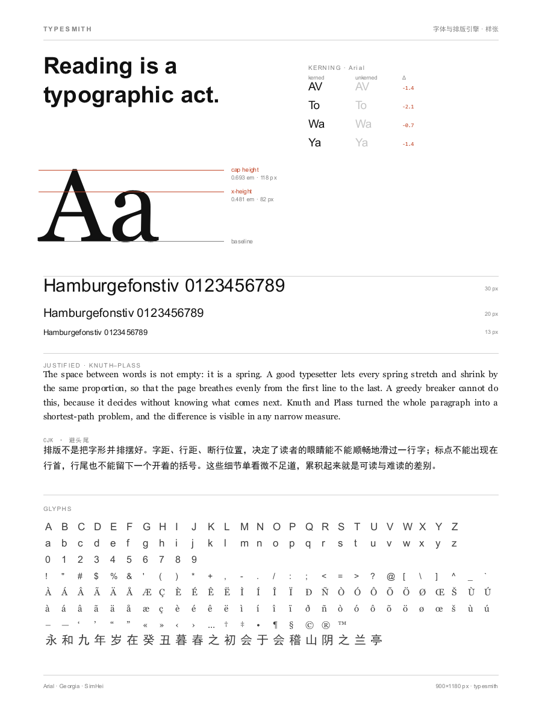
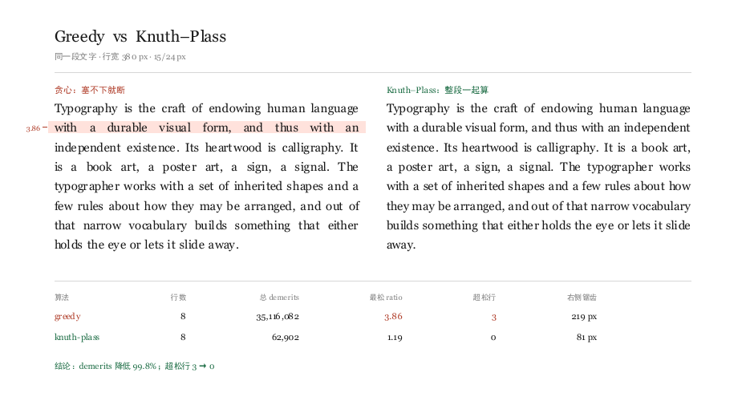
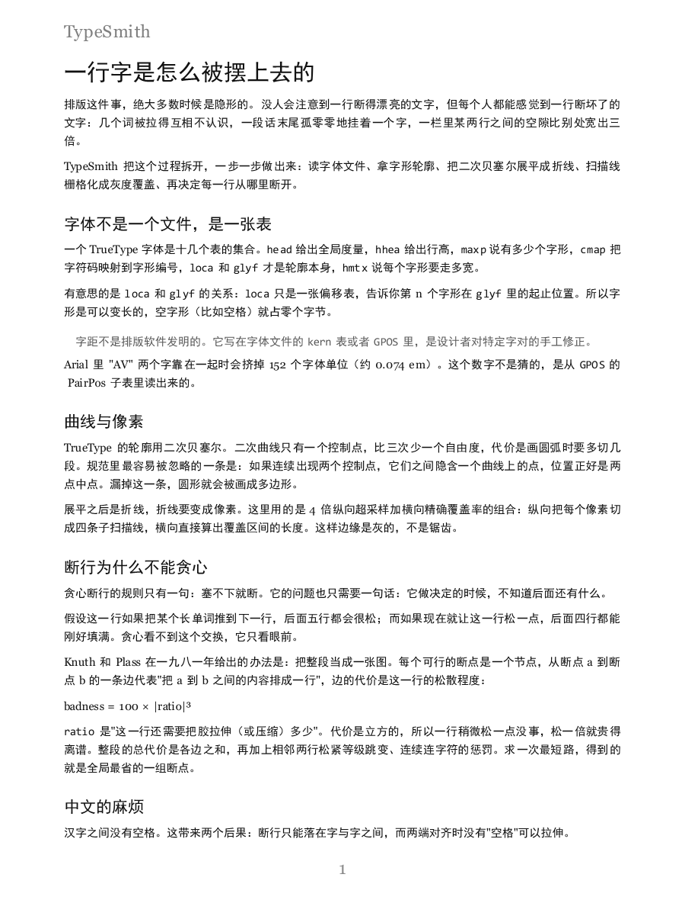
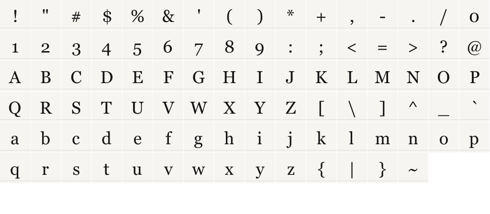

# TypeSmith

**零依赖的字体解析与排版引擎** —— 从 `.ttf` 字节到排好版的一页纸，中间不借助任何第三方库。

读 TrueType 表结构、解析 GPOS 字距、把二次贝塞尔展平成折线、扫描线栅格化成灰度覆盖、
用 Knuth–Plass 求全局最优断点、分页、输出 PNG 与 SVG。整个流程只有 Python 标准库。

```
python run.py specimen --out docs/01-specimen.png     # 字体样张
python run.py compare  --out docs/02-compare.png      # 贪心断行 vs Knuth–Plass
python run.py render   examples/article.md --out-dir out --svg
python run.py serve                                  # 本地工作台 http://127.0.0.1:8790
```



---

## 目录

- [项目简介](#项目简介)
- [效果预览](#效果预览)
- [功能说明](#功能说明)
- [环境与依赖](#环境与依赖)
- [安装与运行](#安装与运行)
- [使用示例](#使用示例)
- [技术方案](#技术方案)
- [目录结构](#目录结构)
- [测试与性能](#测试与性能)
- [设计取舍](#设计取舍)
- [已知限制](#已知限制)
- [License](#license)

---

## 项目简介

大多数"排版"代码其实是调用 FreeType 和 HarfBuzz，再调用系统的断行库。这个项目把这三层
全部自己写了一遍，因为只有自己写一遍，才知道那些数字是从哪个字节算出来的。

引擎做的事，按数据流排：

```
 .ttf / .ttc
     │  font.py       解析表目录、cmap、loca/glyf、hmtx、GPOS
     ▼
 字形轮廓（字体单位，y 向上）
     │  outline.py    二次贝塞尔 → 折线，带容差细分
     ▼
 折线（设备坐标，y 向下）
     │  raster.py     4× 纵向超采样 + 横向精确覆盖率，非零环绕
     ▼
 灰度掩膜（0..255）
     │  render.py     按行定位、按字形贴图
     ▼
 位图 ── png.py ──> .png
     └─ svg.py  ──> .svg（真 Q 曲线，不是折线）

 文本
     │  layout.py     box / glue / penalty 项流；Knuth–Plass 求最短路
     ▼
 行（每行带 ratio、badness、fitness）
     │  document.py   块 → 分页（含孤行寡行修正）
     ▼
 页
```

一行命令跑完全流程，产出可以当证据看的图：不是"好看的截图"，而是每张图上都带着可核对
的数字——字距差多少、每行松紧多少、总代价降了多少。

## 效果预览

### 断行：贪心 vs Knuth–Plass

同一段文字、同一个行宽、同一款字体。左边贪心在第 2 行把空格拉到 3.86 倍宽（浅红底纹），
右边整体重排后最松的一行只有 1.19。



### 分页文档

`examples/article.md` 排出来的第一页：标题层级、两端对齐正文、行内等宽代码、缩进引言、
分隔线、中文避头尾、页脚页码。



### 字形表

ASCII 全字符放大 36 px，用来肉眼检查轮廓展平与栅格化的质量（边缘是灰的，不是锯齿）。



## 功能说明

| 能力 | 说明 |
| --- | --- |
| **TrueType 解析** | `head` `hhea` `maxp` `cmap`(4/12) `loca`(short/long) `glyf` `hmtx` `kern`(fmt 0) `name`；支持 TTC 字体集合 |
| **复合字形** | `MORE_COMPONENTS`、`ARGS_ARE_XY_VALUES`、三种 F2Dot14 变换（scale / xy-scale / 2×2） |
| **字距** | 先 GPOS（`kern` 特性，PairPos format 1/2，含 Extension 9 解包），再退回 `kern` 表 |
| **轮廓** | 二次贝塞尔展平，含"连续两个控制点之间隐含曲线上点"这条规范细节 |
| **栅格化** | 4 倍纵向超采样 + 横向精确像素覆盖率，非零环绕规则，掩膜按 (字形, 字号, ¼ 像素相位) 缓存 |
| **断行** | Knuth–Plass 全量动态规划：box/glue/penalty 项流、三次 badness、fitness 跳变惩罚、parfillskip |
| **中文** | 汉字之间插入可拉伸的零宽胶；避头尾用字符集合在项流阶段处理 |
| **分页** | 页眉页脚、分隔线、缩进引言、孤行寡行修正 |
| **输出** | PNG（自写编码器，Up 滤波）、SVG（真二次曲线路径） |
| **界面** | 命令行 7 个子命令 + 本地 HTTP 工作台（参数调节、实时预览、断行诊断） |
| **零依赖** | 不依赖 FreeType / Pillow / numpy / Flask；只用 `struct` `zlib` `http.server` 等标准库 |

## 环境与依赖

- Python **3.10+**（用到 `X | Y` 类型标注与 `dataclasses`）
- **无第三方依赖**：`requirements.txt` 是空的，这是设计目标而不是巧合
- 需要系统里有至少一款 `.ttf` / `.ttc` 字体。程序会在下列目录里找：

  | 平台 | 目录 |
  | --- | --- |
  | Windows | `C:\Windows\Fonts` |
  | macOS | `/System/Library/Fonts`、`/Library/Fonts`、`~/Library/Fonts` |
  | Linux | `/usr/share/fonts`、`~/.fonts`、`~/.local/share/fonts` |

  中文断行需要一个中文字体（Windows 的 SimHei / 微软雅黑，macOS 的 PingFang，
  Linux 的 `fonts-noto-cjk`）。没有中文字体时，引擎照常工作，只是中文会落到方框。

## 安装与运行

```bash
git clone https://github.com/18971181532/typesmith.git
cd typesmith
python run.py fonts          # 先看看这台机器上有哪些字体
```

不需要 `pip install`。想装成命令也可以用：

```bash
pip install -e .             # 之后可以直接敲 typesmith
```

### 命令行

```bash
# 1) 字体发现：列出扫到的字体、默认角色分配、每款字体的字形数
python run.py fonts

# 2) 看一款字体的表结构与度量（--glyphs 附带 cmap 抽样）
python run.py info C:/Windows/Fonts/arial.ttf --glyphs

# 3) 生成样张
python run.py specimen --out docs/01-specimen.png

# 4) 只跑断行，把每行的松紧打印出来
python run.py layout --text "……" --size 15 --measure 320

# 5) 断行对照图
python run.py compare --out docs/02-compare.png

# 6) 排版 + 分页 + 导出
python run.py render examples/article.md --out-dir out --svg --stats

# 7) 本地工作台
python run.py serve --port 8790
```

`layout` 的输出长这样，可以直接看出哪一行被拉得太开：

```
断行结果   Georgia 15.0px / measure 380
 #     宽度   ratio  松紧          fitness     文本
 1    361.1   +1.08  ···|········  very loose  Typography is the craft of endowing hu
 2    391.5   -0.77  |···········  tight       with a durable visual form, and thus w
 3    371.6   +0.37  ·|··········  decent      existence. Its heartwood is calligraph
 4    353.3   +1.19  ····|·······  very loose  a poster art, a sign, a signal. The ty
 ...
 8     37.6   +0.03  |···········  decent      away.
──────────────────────────────────────────────────────────────────────────
Knuth–Plass 8 行  demerits 62,902  最大 ratio +1.19
贪心断行   8 行  demerits 35,116,082  最大 ratio +3.86
总代价降低 99.8%   用时 34 ms
```

左边那列 `松紧` 是以 0 为中心画的小条：`|` 落在越右边，说明这一行被拉得越开。

### 作为库

```python
from typesmith import Font, LayoutOptions, layout_paragraph, FontBook, build_document

font = Font("C:/Windows/Fonts/georgia.ttf")
print(font.family, font.num_glyphs, font.units_per_em)
print(font.kerning(font.glyph_id(ord("A")), font.glyph_id(ord("V"))))   # -152（字体单位）
print(font.text_width("AVATAR", 16))                                    # 像素宽度，含字距

# 只断行
lines = layout_paragraph(
    "要断行的段落……", [font], LayoutOptions(size=15, measure=320)
).lines
for line in lines:
    print(f"{line.ratio:+.2f}  {line.text}")

# 排成分页文档，导出 PNG / SVG
doc, stats = build_document("# 标题\n\n正文……", FontBook(), size=15)
from typesmith import Renderer, encode_png, document_svg
bmp = Renderer(doc).page_bitmap(doc.pages[0])
open("page1.png", "wb").write(encode_png(bmp.width, bmp.height, bytes(bmp.pixels)))
open("page1.svg", "w", encoding="utf-8").write(document_svg(doc))
```

### HTTP 工作台

```bash
python run.py serve
```

打开 `http://127.0.0.1:8790`，四个面板：

- **样张** —— 换字体、改画布尺寸，实时重画
- **断行** —— 调字号/版心/容差，逐行给出 ratio 与 badness，并和贪心算法比总代价
- **分页** —— 编辑标记文本，翻页看渲染结果
- **对照** —— 生成并排对照图

前端只有 `web/index.html`、`style.css`、`app.js` 三个文件，没有构建步骤。

| 端点 | 方法 | 用途 |
| --- | --- | --- |
| `/api/fonts` | GET | 角色分配 + 系统字体清单 |
| `/api/info?path=` | GET | 单款字体的表结构与度量 |
| `/api/layout` | POST | 断行结果（每行 ratio / badness / fitness） |
| `/api/doc` | POST | 页数、行数、每行松紧 |
| `/api/render` | POST | 单页 PNG |
| `/api/render.svg` | POST | 矢量页 |
| `/api/specimen` | POST | 样张 PNG |
| `/api/compare` | POST | 断行对照 PNG |

## 技术方案

### 1. 字体：表目录是一张偏移表

一个 TrueType 文件是十几个表的集合。表目录本身很简单，但有个坑：

```python
def tag(self) -> str:
    out = self.data[self.pos:self.pos + 4].decode("latin-1")
    self.pos += 4          # ← 漏了这一行，整张表目录会错位 4 字节
    return out
```

漏掉这一行，读到的第一个表名看起来是对的（`head`），但后面每一个字段都是错的，
最终表现为"缺少必需的表：head"。

复合字形（带重音符号的字母、连字）用仿射变换引用别的字形，变换用 F2Dot14 定点数存：

```python
if flags & _WE_HAVE_A_SCALE:
    scale = r.f2dot14()
    matrix = (scale, 0.0, 0.0, scale)
elif flags & _WE_HAVE_AN_X_AND_Y_SCALE:
    sx, sy = r.f2dot14(), r.f2dot14()
    matrix = (sx, 0.0, 0.0, sy)
elif flags & _WE_HAVE_A_TWO_BY_TWO:
    matrix = (r.f2dot14(), r.f2dot14(), r.f2dot14(), r.f2dot14())
```

### 2. 字距：字段是按位出现的

`ValueRecord` 是 GPOS 里最容易读错的结构。它不是"固定布局 + 可选字段"，而是**按位图决定
哪些字段存在**：

```
bit 0  XPlacement   bit 4  XPlacementDevice
bit 1  YPlacement   bit 5  YPlacementDevice
bit 2  XAdvance     bit 6  XAdvanceDevice
bit 3  YAdvance     bit 7  YAdvanceDevice
```

只设了 `XAdvance`（`valueFormat = 0b0100`）时，记录里只有一个 i16，它就是 xAdvance；
把它当成 xPlacement 读，所有字距会静默变成 0——不报错，只是不生效。

```python
vals = [0, 0, 0, 0]
for bit in range(4):
    if fmt & (1 << bit):
        vals[bit] = r.i16()          # ← 按下标填，不是按顺序填
```

现代字体还会把 PairPos 包在 Extension（lookup type 9）里，`_read_pair_pos` 必须先解包再解析，
并且所有子表偏移都相对子表自身、游标是共享的——所以要先读完所有偏移量，再去跳转。

最终 Arial 读出 `AV = -152`、`To = -227`、`Vo = -113`（字体单位，upem 2048，即 −0.074 em）。
这类数字可以直接和字体编辑软件对照。

### 3. 轮廓：二次贝塞尔的隐含中点

TrueType 只有二次贝塞尔。一条轮廓是一串点，每个点带一个"在曲线上"标志。规则是：

- 曲线上点 → 曲线上点：直线
- 曲线上点 → 控制点 → 曲线上点：一段二次曲线
- 控制点 → 控制点：**两者中点隐含一个曲线上点**，曲线在这里被切开

第三条最容易漏。漏了它，圆形会被画成八边形；因为字体里的圆通常是四个控制点一组，
没有曲线上点。

整条轮廓都是控制点的情况（真正的整圆）还要特殊处理：起点取首尾控制点的中点。

展平用一个递归的中点细分，判据是控制点到弦的距离小于容差（默认 0.12 px）：

```
        C
       / \          控制点 C 到弦 AB 的距离 h
      /   \         h < tol  → 直接用 AB
     A-----B
```

### 4. 栅格化：交错采样

纵向把每个像素切成 4 条子扫描线，横向不采样、直接算覆盖区间：

```
for 每条子扫描线 y:
    求所有跨过 y 的边 → 交点 + 环绕方向
    排序，按非零环绕规则求出填充区间 [x0, x1)
    把区间长度按 1/4 权重累加到像素上
```

这里有个已经踩过的坑：活跃边表里必须保存**边的原始 (x0, y0) 与斜率**，每次用绝对值求交点：

```python
x = x0 + (ys - y0) * slope        # 对
x += slope                        # 错：边会随行号漂移，画出来是一道道横纹
```

掩膜按 `(字形, 字号, ¼ 像素水平相位)` 缓存。缓存相位是为了让亚像素定位的字形不抖动——
同一字号下，一个字形最多算 4 次，一页正文实际只栅格化几十次。

### 5. 断行：为什么不能贪心

贪心只看当前行。它不知道"这一行松一点，后面五行都能刚好填满"。Knuth–Plass 把整段
变成最短路问题：

```
badness  = 100 · |ratio|³
demerits = (line_penalty + badness)² ± penalty²
           + fitness_demerit · [相邻两行松紧等级差 > 1]
           + flagged_demerit · [连续两个断点都带连字符]
```

`ratio` 是"这一行的胶还要拉伸（或压缩）多少"。取三次方是因为视觉上"稍微松"可以接受，
"松一倍"就无法忍受——立方让代价曲线在 1 附近平缓、在 2 以上爆炸。

动态规划维护一个活跃节点列表，每个节点记 `(断点位置, 行号, 松紧等级, 累计代价)`：

- 某行太紧（`ratio < -1`）：再往后只会更紧，这个祖先退休
- 某行太松（`ratio > tolerance`）：祖先还活着，等更长的断点；代价顶格但不剪断
- 同一 `(行号, 松紧等级)` 只保留累计代价最小的节点

第 2 条是**故意偏离 TeX** 的：TeX 会直接剪掉超容差的边，那在窄行宽下会把整张断点图切断，
结果退化成一整行。这里把 badness 顶到上限 `INF_BAD` 但仍然连线，让最短路自己去回避。

段末还要插一个 `parfillskip`（无限可拉伸的胶），否则最后一行永远"太松"，整段会退化。

正确性靠一个暴力测试守着：小规模下枚举所有断点组合，与 DP 的结果必须一致。

### 6. 中文：两个独立的问题

**断点**：汉字之间没有空格，必须允许在任意两字之间断行。但同时句号、逗号、右括号不能
出现在行首，左括号、前引号不能留在行尾。做法是在生成项流时就抹掉不合法的断点位置，
而不是先断行再回退修补——修补会让已经算好的最优点全部作废。

**对齐**：两端对齐需要可拉伸的胶，而汉字之间没有空格。所以在两字之间插入一个零宽、
可拉伸的胶，拉伸量控制在 `0.05 em` 左右（可调），再大就会看出来字在"喘气"。

### 7. 分页

竖排断页用"贪心 + 孤行寡行修正"就够了，不需要全局搜索——页高固定，代价函数简单到
不值得做最短路：按可用高度顺序往下填，遇到"段落只剩一行在本页"或者"下一页开头只剩
一行"时，把整段或一行挪一下。

## 目录结构

```
typesmith/
├── typesmith/                 # 引擎（19 个模块，≈4,500 行，零依赖）
│   ├── __init__.py            # 公共 API 与 __version__
│   ├── __main__.py            # python -m typesmith
│   ├── binary.py              # 大端字节流读取器 + FontError
│   ├── font.py                # sfnt/TTC 解析、cmap、glyf、hmtx、复合字形
│   ├── gpos.py                # GPOS PairPos（format 1/2 + Extension）
│   ├── outline.py             # 二次贝塞尔展平
│   ├── raster.py              # 扫描线栅格化、Bitmap、GlyphMasker
│   ├── png.py                 # PNG 编码器（IHDR/IDAT/IEND + Up 滤波）
│   ├── layout.py              # 项流、Knuth–Plass、贪心对照、行内定位
│   ├── document.py            # 块解析、分页、孤行寡行修正
│   ├── render.py              # 按行画字（含中英混排回退）
│   ├── svg.py                 # 矢量页输出
│   ├── specimen.py            # 字体样张
│   ├── compare.py             # 断行对照图
│   ├── system.py              # 跨平台字体发现
│   ├── service.py             # "参数 → 文档"的顶层封装
│   ├── console.py             # 终端表格、颜色、UTF-8 修补
│   ├── cli.py                 # 7 个子命令
│   └── server.py              # http.server 工作台后端
├── web/                       # 工作台前端（无框架、无构建）
│   ├── index.html
│   ├── style.css
│   └── app.js
├── tests/                     # 142 个用例，10 个文件
│   ├── test_binary.py         # 读取器、越界、tag 游标
│   ├── test_font.py           # 真实字体集成、TTC、坏文件
│   ├── test_gpos.py           # ValueRecord 位语义、Coverage/ClassDef
│   ├── test_outline.py        # 隐含中点、整圆、y 轴翻转
│   ├── test_raster.py         # 覆盖率、孔洞、边缘抗锯齿
│   ├── test_png.py            # 块结构、CRC、滤波、像素往返
│   ├── test_layout.py         # DP 与暴力枚举对齐、K–P 不劣于贪心
│   ├── test_document.py       # 标记解析、行内代码、分页约束
│   ├── test_service.py        # 字体角色、文档构建、两种图
│   └── test_server.py         # 路由、参数钳制、路径穿越防护
├── examples/article.md        # 示例文章（标题/引言/代码/中文）
├── docs/                      # 生成的示例图
├── run.py                     # 命令行入口
├── run_tests.py               # 测试入口
├── run_demos.py               # 一次生成全部示例图
├── pyproject.toml
└── .github/workflows/tests.yml
```

## 测试与性能

```bash
python run_tests.py            # 142 个用例，约 10 秒
python run_tests.py layout     # 只跑 test_layout*
```

测试分两类：**合成的**（自己拼项流，不依赖字体，CI 上数字完全一致）和**集成的**
（真实的系统字体，没有字体就 `skip`）。几个值得一提的用例：

- `test_matches_exhaustive_search` —— 枚举所有断点组合，验证 DP 真的求到了最优
- `test_knuth_not_worse_than_greedy` —— 六个行宽下逐个比较，K–P 的总代价必须 ≤ 贪心
- `test_hole_with_reverse_winding` —— 反向环绕必须挖出孔洞（"o" 的内圈）
- `test_cjk_page_actually_has_ink` —— 整页中文必须画出字来（曾经因为一行共用拉丁字体的掩膜，汉字全是空白）
- `test_static_traversal_blocked` —— `/static/../typesmith/font.py` 必须 404

本机（Windows 11 / Python 3.13 / 549 个字体文件）实测：

| 操作 | 规模 | 耗时 |
| --- | --- | --- |
| 扫描字体目录 | 549 个文件 | 1 ms（系统缓存命中） |
| 排版一篇文章 | 1,443 字符 / 37 行 / 2 页 | ~370 ms（含首次载入 6 款字体） |
| 单页渲染 | 900 × 1180 | ~160 ms |
| PNG 编码 | 900 × 1180（3.2 MB 像素） | 25 ms |
| 单个字形掩膜 | 15 px | 0.17 ms |
| 样张 | 900 × 1180，约 700 个字形实例 | 0.23 s |

生成一张对照图只要 70 ms，所以工作台里拖滑块是"跟着手走"的。

## 设计取舍

**为什么不用 FreeType / HarfBuzz？** 用了就没有这个项目了。这里的取舍是明确的：
放弃 shaping 的完备性（GSUB 连字、变体轴、复杂文种重排），换取"每一层都能读懂"。

**为什么自己写 PNG 编码器？** `zlib` 是标准库，PNG 就是 zlib 加三个块。自己写反而比
引入 Pillow 更清楚：文字页面整行相同的地方很多，用 Up 滤波能把文件压到 1/3。

**为什么 tolerance 是软上限？** TeX 硬剪枝在宽行宽下没问题，在窄行宽（比如 200 px 装中文）
下会把断点图切成碎片。软上限保留了连通性，代价是极端情况下可能选出一条很松的行——
但总比"整段排成一行"好。

**为什么中文胶用 0.05 em 的拉伸量？** 试出来的。0.1 em 时，两端对齐的段落里汉字之间
会出现肉眼可见的、不均匀的缝；0.02 em 时又拉不满版心。

**为什么前端不用框架？** 总共三个文件、一个状态对象，`fetch` + `img.src` 就够了。
引入构建步骤会让"clone 下来就能跑"这条断掉。

## 已知限制

诚实地列出来：

- **只支持 TrueType 轮廓**（`glyf`）。CFF/OTF 会明确报错，而不是画出空白。
- **没有 shaping**：GSUB 连字（`fi` → `fi`）、mark 定位、阿拉伯文/印度文的字形重排都不支持。
  中文和拉丁文够用，复杂文种不行。
- **没有 hinting**：小字号（≤ 10 px）的笔画会比商业渲染器软一些。
- **变体字体**只读默认实例，不解析 `fvar` / `gvar`。
- **断行不连字符**：英文长单词超出容器时会被硬断，而不是加连字符。`penalty` 的连字符
  通路已经在数据结构里，缺的是词典。
- **只做横排**，没有竖排（`vert` / `vrt2`）。
- **分页是贪心的**，没有做跨页的最优断页。
- 单线程。工作台的并发靠 `ThreadingHTTPServer`，但栅格化本身没有并行化。

## License

MIT，见 [LICENSE](LICENSE)。
